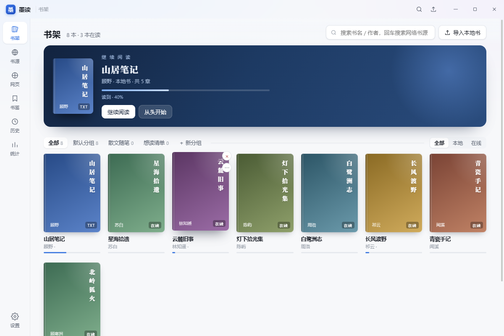
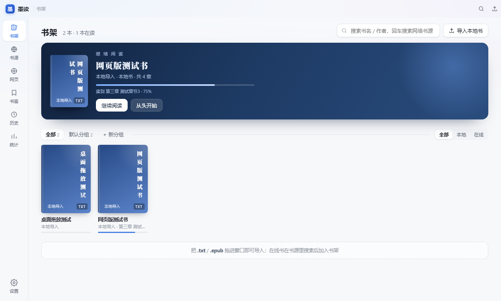
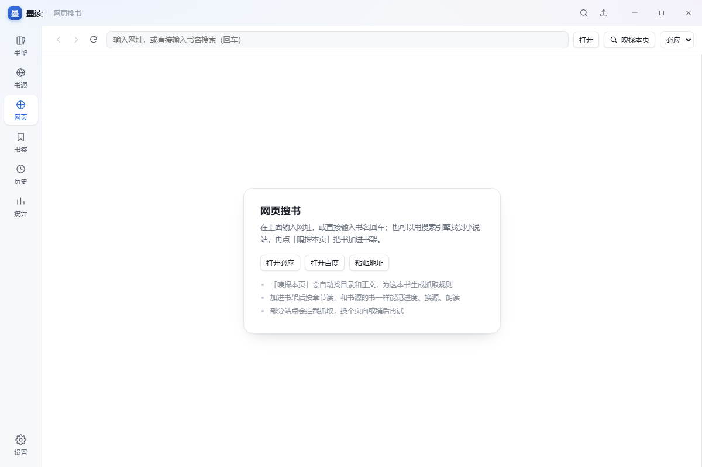
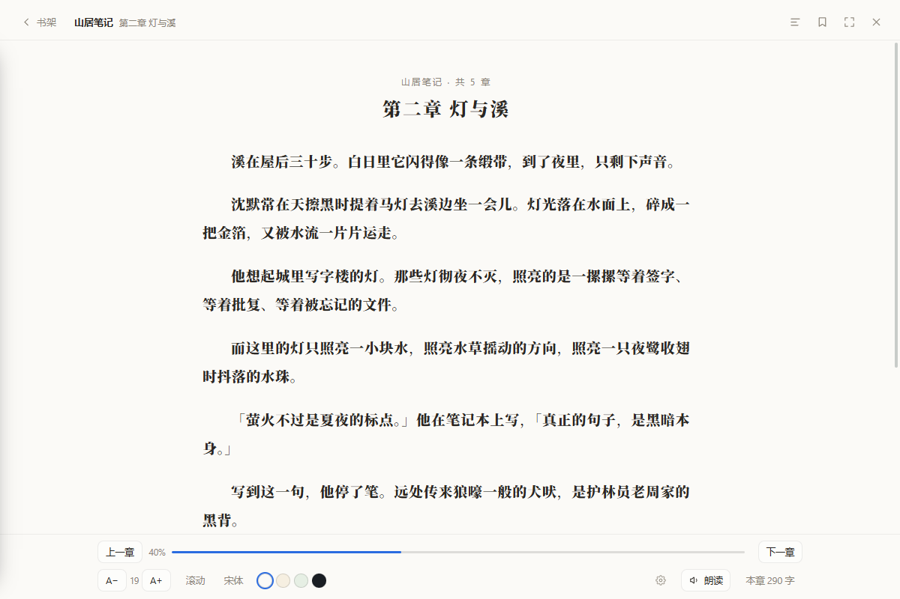
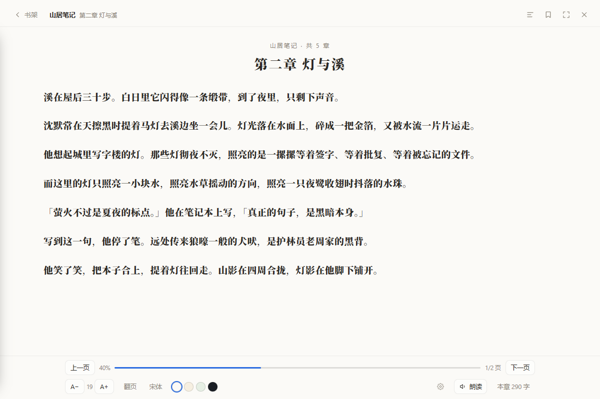
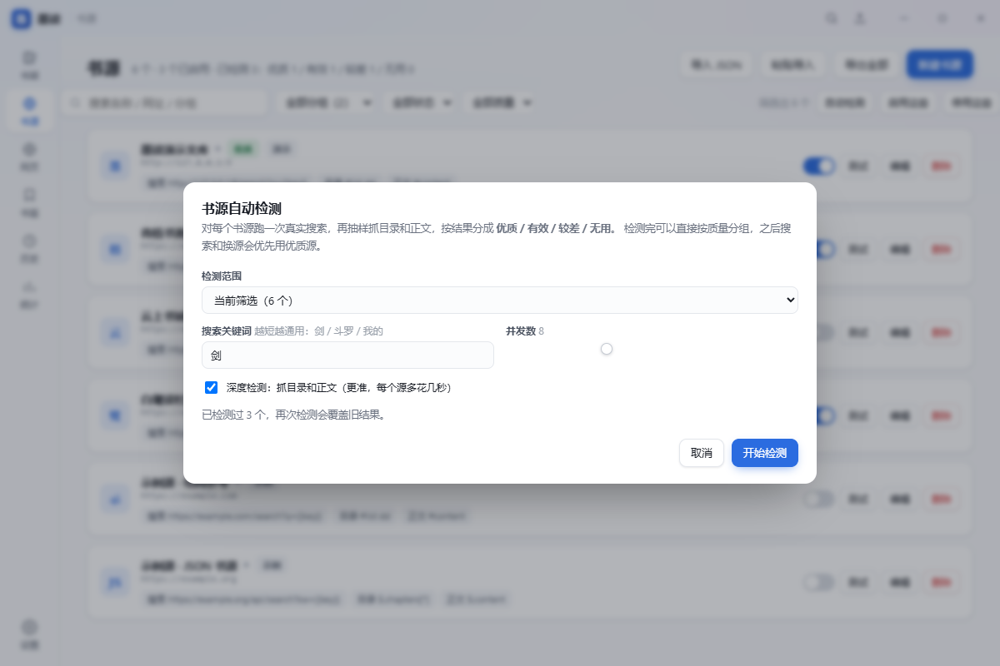
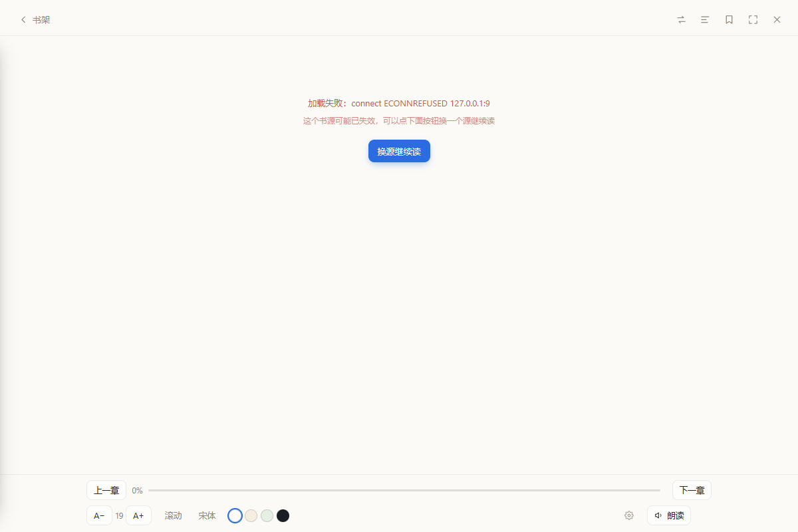
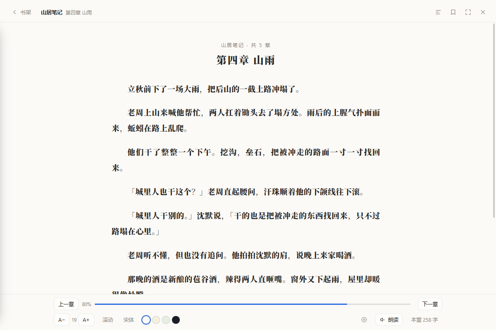

# 墨读 · 开源阅读

   

> 起因： <https://gedoor.github.io/download> 只有 Android 版的「开源阅读 Legado」，没有桌面端。
> 这个项目按 Legado 的使用习惯重写了一版桌面端：**本地书 + Legado 书源 + 网页搜书 + 坚果云同步**，
> 存档格式与原版「阅读」双向兼容，可以直接导入原版「阅读」导出的 zip 备份。
> 同一套 `ui/` 跑在七个地方：Windows / Linux / macOS / Android / 浏览器 / 鸿蒙 / iOS。

**下载**（全平台产物都在 [Releases · v0.6.12](https://github.com/RoutineMiku/MoRead-Windows/releases/tag/v0.6.12)，各平台同一套 `ui/`）：

| 平台 | 文件 | 说明 |
| --- | --- | --- |
| Windows x64 | [`MoRead-windows-0.6.12.zip`](https://github.com/RoutineMiku/MoRead-Windows/releases/download/v0.6.12/MoRead-windows-0.6.12.zip) | 解压后双击 `墨读.exe`，免安装、不写注册表，数据跟着程序走 |
| Android 7+ | [`MoRead-android-0.6.12.apk`](https://github.com/RoutineMiku/MoRead-Windows/releases/download/v0.6.12/MoRead-android-0.6.12.apk) | 直接安装，WebView 内置 Node 兼容层（versionCode 612） |
| Linux x64 | [`MoRead-linux-x64-0.6.12.tar.gz`](https://github.com/RoutineMiku/MoRead-Windows/releases/download/v0.6.12/MoRead-linux-x64-0.6.12.tar.gz) | 解压 → `./moread` 运行；`./install.sh` 装进应用菜单 |
| Linux arm64 | [`MoRead-linux-arm64-0.6.12.tar.gz`](https://github.com/RoutineMiku/MoRead-Windows/releases/download/v0.6.12/MoRead-linux-arm64-0.6.12.tar.gz) | 同上，树莓派 / ARM 小主机 |
| macOS Intel | [`MoRead-mac-x64-0.6.12.zip`](https://github.com/RoutineMiku/MoRead-Windows/releases/download/v0.6.12/MoRead-mac-x64-0.6.12.zip) | 未签名：首次右键 → 打开，或 `xattr -dr com.apple.quarantine MoRead.app` |
| macOS Apple Silicon | [`MoRead-mac-arm64-0.6.12.zip`](https://github.com/RoutineMiku/MoRead-Windows/releases/download/v0.6.12/MoRead-mac-arm64-0.6.12.zip) | 同上 |
| 鸿蒙 4.x 及以下 | 同上 APK | 系统自带安卓兼容，直接装 |
| 鸿蒙 NEXT (5.0) | [`MoRead-harmony-0.6.12.hap`](https://github.com/RoutineMiku/MoRead-Windows/releases/download/v0.6.12/MoRead-harmony-0.6.12.hap) · [自签版](https://github.com/RoutineMiku/MoRead-Windows/releases/download/v0.6.12/MoRead-harmony-0.6.12-signed.hap) | ArkWeb 壳；未签名包用 DevEco 自动签名或自己的证书，自签版可直接 `hdc install`，见 `harmony/README.md` |
| iOS 15+ | [`MoRead-0.6.12-unsigned.ipa`](https://github.com/RoutineMiku/MoRead-Windows/releases/download/v0.6.12/MoRead-0.6.12-unsigned.ipa) | 未签名 ipa（GitHub Actions 的 macOS runner 编的），Sideloadly 填自己 Apple ID 装，见 `ios/README.md` |
| 网页版 / iPad PWA | **<https://routinemiku.github.io/MoRead-Windows/>** | 免安装免账号，Safari「添加到主屏幕」即得全屏图标 |

各平台怎么打、有哪些已知限制：**[docs/platforms.md](docs/platforms.md)**




## 网页版（iOS / iPad / 浏览器）

同一套 `ui/` + `src/` 代码跑在浏览器里，原生能力由 `web/bridge-web.js` 顶替（安卓是 Kotlin 的 `MoBridge`）：

| 能力 | 实现 |
| --- | --- |
| 数据存储 | IndexedDB 虚拟文件系统（书架 / 进度 / 章节缓存 / 本地书全文），**只存在这台设备上**，不上传任何服务器 |
| 本地书 | 点「导入本地书」选 txt / epub；桌面浏览器还可以直接把文件拖进窗口 |
| 在线书源 | 需自填代理（浏览器 CORS 限制，见下）；不填则完全不发起网络请求 |
| 朗读 | 浏览器自带 `speechSynthesis` |
| 离线 | Service Worker 缓存应用外壳，断网也能打开和读已导入的书 |

**为什么要自填代理**：浏览器出于安全不允许网页直接抓任意网站，书源请求必须经一个转发端点。为了让数据不经过作者的服务器，这里**不内置任何代理**，由使用者在自己的 Cloudflare Workers（免费额度每天 10 万次）里部署一个十来行的转发：

```js
export default {
  async fetch(req) {
    const u = new URL(req.url).searchParams.get('url');
    if (!u) return new Response('missing url', { status: 400 });
    const r = await fetch(u, { headers: { 'user-agent': 'Mozilla/5.0' } });
    return new Response(r.body, {
      status: r.status,
      headers: { 'access-control-allow-origin': '*', 'content-type': r.headers.get('content-type') || 'text/plain' }
    });
  }
};
```

部署后把地址（形如 `https://xxx.workers.dev/?url=`）填进「设置 → 书源代理地址」即可。留空 = 纯本地模式。

**注意**：网页版数据默认存在浏览器里，清理「网站数据」/ 无痕模式会连同书架一起清掉；重要书籍建议用设置里的「导出备份 zip」留一份。
如果想让书架存在**自己的一台机器**上、家里所有设备共用同一份，见下面的「自托管」。

### 换手机 / 换电脑怎么搬

1. 旧设备：设置 → 备份与恢复 → **完整备份（含本地书文件）** → 完整导出，得到一个 zip（本地书的正文也在里面）
2. 新设备：设置 → 备份与恢复 → **从备份恢复** → 选择文件 → 「合并进现有书架」
3. 打开书架上的书接着读，进度会跟过来

只导「导出备份 zip」（不含本地书）也能搬书架、书源、书签和进度，但本地书点开会提示正文缺失——重新导入一次原 txt / epub 即可。恢复完成时如果缺正文，界面会直接告诉你有几本、怎么补。

 

本地开发：`npm run web`（生成 `dist-web/`）→ `npm run web:serve`（<http://127.0.0.1:8099/> 预览）→ `GH_TOKEN=... npm run web:deploy`（发布到 GitHub Pages）。

### 自托管：家里一台机器，全屋共用一份书架

`server/gateway.js` 是一个零依赖的单文件服务（Node >= 18，只用内置模块），同时做三件事：
托管 `dist-web`、给在线书源做同源抓页代理 `/fetch`、把书架/书源/进度**存到服务器磁盘** `/api/fs`。

```bash
node build/gen-web.js
DATA_DIR=./data STATIC_DIR=./dist-web PORT=8080 node server/gateway.js
# 浏览器打开 http://<机器IP>:8080/
```

前端会自动探测 `/api/fs/ping`：探测到就进「设备存储」模式（换设备、清缓存、无痕模式都不丢，
两台设备并发写会提示冲突而不是静默覆盖）；探测不到就仍是原来的浏览器本地存储，
**同一份 `dist-web` 放到 GitHub Pages 也照常用**。网关还会自动注入书源代理地址，
手机第一次打开就能搜书，不用手工填代理。

完整说明（`/api/fs` 协议、缓存指纹、SSRF / fake-ip 开关、systemd 示例、安全边界）
见 [docs/self-hosting.md](docs/self-hosting.md)。

## 运行 · Windows

| 方式 | 说明 |
| --- | --- |
| 免安装使用 | 解压 `墨读-win32-x64.zip`，双击 `墨读.exe`（不写注册表，数据在程序目录 `data\`） |
| 开发调试 | `npm install` → `npm start` |
| 打包 | `npm run dist` → `dist/墨读-win32-x64/` + `dist/墨读-win32-x64.zip`（直接复用 `node_modules/electron` 运行时，不需要联网下载） |

> 小坑：如果终端里设了 `ELECTRON_RUN_AS_NODE=1`，Electron 会以纯 Node 方式启动并立刻退出，
> 用 `env -u ELECTRON_RUN_AS_NODE npm start` 即可。


## 功能

### 书架
- 拖入 `.txt` / `.epub` 自动导入；TXT 支持 UTF-8/GBK 探测 + 「第 X 章」分章，EPUB 走 OPF/spine + nav/ncx
- EPUB 里的插图会跟着正文一起显示（按图片原尺寸，单图最高占一屏约六成，不会被裁；配套图片以 base64 内嵌进章节缓存，不额外产生文件）
- 分组、本地/在线筛选、继续阅读卡片、进度条
- **继续阅读卡片左右齐平**：左边封面和右边文字块同高，上面「继续阅读」贴着封面顶边、下面按钮贴着封面底边，
  不再是「封面居中、按钮悬在半空」
- **排序方式可调**：最近阅读（默认）/ 最近加入 / 书名（中文按拼音）/ 作者 / 阅读进度 / 最近更新，书架右上角一键切换，分组内同样生效，选择会记住
- **封面大小可调**：小（手机每行三本）/ 中（默认，每行两本）/ 大（单列大图），设置页里也能改
- **章节数只算正文**：出版社的 epub 里，封面页 / 书名页 / 版权页 / 目录页跟正文一样都是 spine 里的一节，
  以前它们和前言、序、附录、后记一起被算成「章」，一本 40 章的书能显示成 47 章，目录序号也跟着错位。
  现在纯图片页（封面）直接跳过，前言 / 序 / 附录 / 后记 / 致谢 / 完本感言归到「卷首 · 附录」一组，
  不计入章节数；正文按 1..N 连续编号，点哪条读哪章（内部索引不变，老书重新打开一次即生效）
- 右键或「⋯」：归组、更新目录、**换源**、移出书架
- EPUB 里的图片三种写法都认：普通 ``、calibre 打包的 `<svg><image xlink:href="cover.jpeg"/></svg>` 外壳、
  以及矢量 `<svg>` 折线图。calibre 转出来的那种 svg 外壳，图片地址会被读出来重新内嵌 —— 以前这类插图是一片空白

### 扩展（书源 / 阅读历史 / 阅读统计 / 添加扩展）
侧栏只留 **书架 / 扩展 / 设置** 三个入口，其余功能都收进「扩展」：
- 进去是三个卡片（书源 · N 个、历史 · N 条、统计 · 今天读了多少），点进去就是原来的整页功能，左上角「← 扩展」退回菜单
- 以后加新功能（比如订阅、字典、自定义主题）都在这里挂一张卡，不用再往侧栏挤
- 手机竖屏同样是一列卡片，返回键先回扩展菜单再回书架

**添加扩展**（菜单最后一张虚线卡）是给开发者留的口子：
- 打开就是一页教程：扩展格式、三步流程、面板能用的宿主接口，页内还能一键「填入示例」直接跑起来
- 导入方式三种：把 `.json` / `.html` 拖进窗口、粘贴内容后点「导入」、点「选文件」挑一个（手机上是系统文件选择器）
- 导入成功后扩展菜单立刻多一张卡，点开就是面板；「已安装」里可以打开 / 移除，同名再导入会问一次覆盖
- 面板是 sandbox iframe，读不到书库和存档，需要数据就走 `postMessage`（`toast` / `context` / `search` / `openBook` / `shelf`）
- 扩展跟着 `data.json` 存，备份、换设备、导出恢复都一起带走；分发给别人只要给那一个 JSON 文件

### 设置（同样是两级）
设置项越加越多，一页铺到底手机上要划十几屏，所以也拆成了模块入口：
- 进去先看一屏卡片：**阅读 / 朗读 / 书架 / 搜索与网络 / 数据与备份 / 云端同步 / 系统 / 关于**，
  右边挂着当前状态（`22px · 1.7 行距`、`自动下一章`、`本机目录`、`已配置`、`v0.6.11`），点进哪张只看那一组
- 「← 设置」或手机返回键退回菜单，再退才回书架；改动照旧即时生效，没有「保存」按钮
- 原来挤在「系统」里的书架排序、封面大小、搜索并发与书源数分到了各自模块，数据目录/缓存和导出恢复合成「数据与备份」
- 窄屏放不下「名字 + 说明 + 状态 + 箭头」四样时先舍状态，保证说明完整一行

### 书源（对标 Legado）
- 导入 Legado 书源 JSON（文件或粘贴），字段映射 `bookSourceName` `bookSourceUrl` `searchUrl` `ruleSearch` `ruleBookInfo` `ruleToc` `ruleContent`
- 分组、启停、单源测试（结果数/耗时/失败原因）、导出全部
- 规则支持：
  - CSS + `@text` / `@href` / `@src` / `@html`，如 `#list dd a@href`
  - Legado 旧语法 `class.item@tag.h3@tag.a@text`（自动转 `.item h3 a`），支持 `.0` / `.-1` 取位、`!0` / `!-1` / `!0:2` 剔除
  - **`text.可见文字@href`**（`text.下一页@href`、`text.点击阅读@href` 这类原版高频写法）
  - **JSON 规则 `@JSon:` / `$` 路径**，含 `..` 递归下降与 `[*]` 通配：`@JSon:$.data.volumes..chapters[*]`
  - `{{表达式}}` / 规则后接 `@js:`（如 `@JSon:$.id@js:"chapter/"+result+"/content"`）
  - 后处理 `##正则`（删除）/ `##正则##替换` / `###正则`（只取匹配）
  - `||` 备选规则、`&&` 并列取值
- 目录抓取：规则解析 → 详情页「目录/全部章节」入口跟随 → 常见目录容器兜底 → `ruleToc.nextTocUrl` 自动翻页（最多 20 页）
- 正文抓取：规则命中 + 常见容器 + 整页最长文本块，多路候选按「正文质量分」择优，自动剔除导航/广告行
- 站点证书过期/自签名时自动降级重试（不少小说站证书早过期，不降级会整站打不开）
- 打不开时会说清原因：`404 地址失效` / `403 站点拒绝访问（可能有反爬验证）` / `请求超时`，阅读页直接给「换源继续读」按钮
- 多源并发搜索（1~6 可调），先返回先显示
- **坚果云云同步**：一键上传/下载 `bookSource.json`，和手机上的原版「阅读」共用同一份书源
- **自动检测分级**：对书源批量跑真实搜索，抽样抓目录和正文，把书源分成 **优质 / 有效 / 较差 / 无用** 四类
  - 支持检测范围（当前筛选 / 已启用 / 全部）、并发数、是否深检；有进度条和预计剩余时间、可中断，中途结果实时落盘
  - **判定更准**：站点打不开才算「无用」；站点能打开但搜不到 / 规则不适配只算「较差」，不会再把可用站点误杀掉。搜索命中会挑书名最像的那本深检，书架里用过的地址优先
  - **手机端更快**：同一域名确认打不开后同域书源直接跳过，不再逐个等超时；抖动性超时自动重试一次；并发按设备能力给默认值（手机 5、电脑 8）
  - 3 天内检测过的书源默认跳过（可取消勾选重测），几千个源也不会每次从头测
  - 深度检测会给出每个源的章节数与正文字数；失败原因人话化（`域名解析失败` / `404 地址失效` / `403 反爬` / `请求超时`）
  - 检测完一键「按质量分组」（优质源 / 可用源 / 较差源 / 失效源，原始分组会备份、可还原），也能一键停用无用源
  - 之后搜索和「换源」会自动优先优质源、跳过无用源，换源从「逐个扫几百个源」变成只扫几十个有效源
  - **换源重做**：结果增量追加、不再整体刷新（列表不再乱跳），搜完才按质量排一次；显示进度与预计剩余时间、可随时停止；同一本书 10 分钟内重复换源直接复用上次结果

### 网页搜书（搜索页的一种模式）
- 搜索框左边有个下拉：**书源 / 网页**。选「网页」就是搜整个互联网小说站，选「书源」就是跑本地书源；
  两种模式共用同一个输入框，搜索方式会记住，下次打开还是上次选的
- 网页模式下多出一个引擎下拉（必应、百度、搜狗、360），输入书名回车即可搜索；粘贴网址 → 直接打开站点，站点内可前进后退、刷新
- **搜索结果按「书」归并**（手机端与书源搜索一致）：十条链接洗成 `书名 + 作者 + 站点标签`，
  百科 / 知乎 / 视频 / 电商结果直接丢掉，同一本书在多个站合成一张卡，点站点标签即可换站
  （「剑来」一次能归并出纵横、速读谷、哔哩小说等 6 个站）
- **嗅探本页**：自动分析当前页面
  - 找出目录（章节链接成组识别，自动生成 CSS 规则）；**粉丝榜 / 书单 / 评论区不算目录**（标题像章节、地址同目录、不像榜单三道校验）
  - 找出正文容器（按文本长度 + 链接密度打分，取「够长且最深」的那层，不会把导航条当正文）
  - 列出页面上的书籍链接，每条都带「预览 / 加入书架」
- **预览**：跟书源搜索一致 —— 先抓这本书的目录（几百章也照抓）、简介、封面，弹窗里能翻目录、点任意一章直接读正文，确认是这本书再加书架
- **目录不全自动补**：详情页常常只挂十来章「最新章节」。嗅探会并行试「页面上的目录链接 / 章节页的返回目录 / 站点的固定目录路径」，
  谁给的章多用谁（纵横那种只给「立即阅读」的 SPA 详情页，也能补到 1306 章）
- 加入书架时会自动跟进「查看目录」链接、抓第一章嗅探正文规则；之后就是一本正常的在线书（记进度、换源、朗读都支持）
- 漫画单话站会顺「下一话」把后续几话串成目录（最多 12 话），不用每话都回浏览器重新加
- 抓不到的站点会退回「最长文本块」兜底提取；验证码 / Cloudflare 挡板会明确提示，不会把「请完成验证码」当正文
- 抓回来的页面按地址缓存 90 秒（网页书「预览 → 试读 → 加入书架」全程只走一次网络），
  桌面端与自建网关还开了长连接复用（同一站点连续抓章不用每次重新握手）

### 阅读
- **两种阅读模式**，设置里一键切换：
  - **滚动**：正文 730px 窄栏居中，鼠标滚轮连续下滑，适合大屏长段落；**滚近章节末尾会自动把下一章接在后面接着滚**，不用翻章、进度和标题跟着所在章节走，加载失败会在文末给「重试」
  - **翻页**：正文按真实书页铺满整屏（左右留白按字号自适应，一行约 58 字上限），点一下翻一页，显示「第 x/y 页」
- 分页是**按可视高度真实切页**：先量出书页能装多少像素，再逐段排版；超长段落会用 Range 在行边界处截断、跨页续排（不会丢字，也不会整段换页留出大片空白）
- 每页顶部对齐、**段落按剩余高度竖向摊开**，页底不留大片空白（手机上按段落边界分页本来会剩小半段，实测 120~160px）
- 页眉首页带书名 + 章节名，翻页后只留一行轻页眉；章末自动进下一章，末章末页提示「已经是最后一章」
- 窗口缩放 / 拉伸后按比例保留当前页，不会跳回章首
- 字号、行距、宋体/黑体、四套主题（纸白/米黄/浅绿/夜间）
- 目录抽屉、章节跳转、进度保存
- **书签在目录抽屉里**，和目录共用同一个面板的两页签（目录 / 书签），不再单独占一个菜单入口：
  - 书签按书归属，只显示当前这本书的，记下章节 + 当时的位置，点一下直接跳回去
  - 同一章可以放多条（读长章时在不同位置各记一条），只有和已有书签位置几乎重合（1.5% 以内）才会挡一次
  - 页签上带条数；添加后在面板里能逐条删除
- 翻页模式下：点正文**左/右两侧**翻页（热区宽度为屏宽 22%，56~130px 自适应），鼠标滚轮、触屏左右轻扫、空格/方向键/PageUp/PageDn 同样可用；底栏按钮文案自动变成「上一页 / 下一页」，不会误以为一下跳一章
- **朗读（TTS）**：Windows 系统语音，可选音色（Huihui / Kangkang / Yaoyao 等）、语速、音调、试听；逐段高亮、读完自动下一章
- **全屏**：右上角按钮或 `F11` / `F`；退出全屏再按一次，或 `Esc`
- 左上角「书架」返回：从搜索/书签/历史任意视图进阅读器，返回都会回到书架
- **换源**：按书名并发搜索，优先「这本书的备份原源 → 书架在用的源 → 优质源」，同组内按备份里的书源顺序排列；书源上千时自动把上限提到 48（设置里可选 24/48/96）。关键词可以直接改——备份里的书名常被拼上角色名，用全名很多站搜不到。切换后按章节标题匹配原进度；每个源 8 秒超时，不被卡死的源拖住
- 退出阅读器再打开另一本书会**彻底复位**：正文、标题、目录、滚动位置和在途请求全部作废，不会残留上一本的内容
- 备份里的进度是**相对原书目录**的索引，站点补全目录 / 换源 / 改版之后同一个索引指的就是另一章（曾出现「书架显示第59章，点进去是第660章」）。现在一律**按章节标题重新定位**：标题完全一致 → 标题包含 → 章节号（`第59章` ↔ `第059章` ↔ `第五十九章`）→ 按比例落位，四级兜底，不再无脑跳最后一章
- 目录页优先用备份里记的 `tocUrl`（书地址常常只是详情页/下载页，那上面只有十几条「最新章节」）；抓完统一**去重 + 按章节号归位**，把站点贴在开头的倒序「最新章节」块排回它该在的位置；章节数明显少于备份总章数时会自动跟「目录 / 全部章节」、翻分页、猜 `index.html`，还不行就提示换源
- 备份里 25 个字段的含义与本项目的映射见 [`docs/legado-backup-fields.md`](docs/legado-backup-fields.md)

### 真实备份实测（原版「阅读」导出，2916 个书源 / 43 本书）

用一份真机备份做过端到端验证：

- 导入：43 本书全部识别、2916 个书源按「站点 URL + 源名」保真去重为 2815 个（同域名不同规则的源不再被丢掉）、41 本阅读进度、1 条书签、分组映射正常
- 阅读：随机抽 15 本，6 本能正常拉到目录与正文（1088 章 / 104 段、1411 章 / 141 段等）；其余多数是站点已关停（域名不解析、404）或有 Cloudflare 反爬验证，这类原版「阅读」同样打不开
- 全链路：多源搜索 40 个源命中 163 条结果 → 加书架自动取到 1088 章 → 打开第一章 123 段正文；失效书「换源」能搜到同名书并定位到原章节

### 存档与备份（与原版互通）
- 进度、书签、历史、统计（时长/字数/连读天数）本地落盘，跨进程重启不丢
- **导出 zip**：内含
  - `moread.json`（墨读完整存档，无损还原）
  - `bookSource.json` / `bookshelf.json` / `bookmark.json` / `readRecord.json` / `bookGroup.json`（Legado 字段，原版「阅读」可直接导入这个 zip）
  - 可选 `files/` 里的本地书原文件
- **导入**：按**文件内容**识别，不看扩展名；支持「合并 / 覆盖」
  - 墨读备份 zip、原版「阅读」备份 zip、zip 里只有一个总 JSON、单个 JSON 整包（含 `bookSource` + `bookshelf`）、纯书源 JSON（裸数组或 `bookSource` / `bookSources` / `sources` / `data` 包裹），以及上述任意格式改叫 `.bak` / `.txt` / 无后缀
  - 单独导入书源按规范化 url 去重，重复导入会提示「新增 0，更新 N」；整包恢复按「url + 源名」保真；几千个书源也用索引查找，不会卡住
  - 恢复原版备份时按 `origin`（书源地址）+ `originName`（源名）**精确绑回每本书原本用的源**，同站多个规则不同的源也不会绑错；`customOrder` 会还原书源顺序，书对象上保留 `origin / originRaw / originName`
  - 重新导入同一份备份会顺手纠正以前绑错的源，但用户手工换过源的书不会被覆盖；同名兜底避免重新导入时多出重复书
  - 原版备份里的手机本地书（`file:///storage/...`）无法跨设备还原，会自动跳过并提示数量
- **坚果云（WebDAV）**：
  - 服务器、账号、应用密码、远程目录（自动创建）
  - 连接测试、立即备份、云端备份列表（恢复 / 删除）
  - 自动备份：每 6/12/24/72 小时一份，只保留最近 N 份
  - 上传/下载书源
  - 兼容坚果云、Nextcloud、群晖等标准 WebDAV

### 联系作者（设置 → 关于墨读）
- 公众号二维码、**抖音码**（抖音号 `RoutineMiku`）都放在关于页里，扫码就能找到人
- 抖音那一行点一下直接复制主页链接（`https://v.douyin.com/9TIIxVCANig/`），粘到抖音里也能打开
- 提问题带上「版本号 + 平台」最快：关于页顶部就写着 `v0.6.x · Windows / Android / 网页版`

## 快捷键

| 操作 | 按键 |
| --- | --- |
| 搜索 / 导入 | `Ctrl+F` / `Ctrl+O` |
| 上/下一章（翻页模式为上一页/下一页） | `←` `→` `PgUp` `PgDn` |
| 翻页（翻页模式） / 翻屏（滚动模式） | `空格`（`Shift+空格` 往回） |
| 滚动 | `↑` `↓` |
| 字号 | `+` `-` |
| 主题 / 目录 / 书签 / 退出 | `T` / `C` / `B` / `Esc` |

## 目录结构

```
src/main.js      Electron 主进程：窗口/托盘/IPC、便携模式、WebDAV、备份打包
src/preload.js   contextBridge 暴露的最小 API
src/store.js     存档：JSON 持久化、原子写入、备份/恢复、章节缓存
src/legado.js    Legado 备份格式互转（bookSource / bookshelf / bookmark / readRecord）
src/webdav.js    WebDAV 客户端（PROPFIND/PUT/GET/MKCOL/DELETE，Basic 认证）
src/net.js       抓网页（绕过 CORS、重定向、gzip、GBK）
src/parse.js     TXT 编码探测+分章 / EPUB 解析
src/zip.js       zip 读 + 写（备份打包用）
ui/engine.js     书源规则引擎 + 任意网页自动识别（目录/正文/书籍链接）
ui/detect.js     书源自动检测分级（优质/有效/较差/无用）
ui/app.js        界面逻辑（书架/书源/网页/阅读器/设置）
ui/style.css     样式（含阅读器四套主题）
web/bridge-web.js 网页版原生桥：IndexedDB 虚拟 FS、设备存储 /api/fs、抓页代理、文件选择
server/gateway.js 自托管网关：静态站点 + /fetch 抓页代理 + /api/fs 设备端存档（零依赖）
docs/self-hosting.md 自托管部署说明
build/gen_icon.py 纯 Python 生成图标
build/pack.js     打包：组装运行时 + 应用代码（先建英文目录再改中文名，避免编码问题）
build/finish.js   打包收尾（裁剪语言包、写便携标记与说明、压缩 zip）
test/             本地模拟站点 + 模拟 WebDAV + 备份/格式测试
test/e2e-real.js  真实备份端到端验证（导入 → 抽书 → 联网拉目录/正文 → 出报告）
test/probe.js     把任意 JS 片段放进真实应用里跑（调试规则/界面用）
test/paged-check.js 翻页模式回归检查（书页是否铺满、有无溢出/丢字、点击与滚轮能否翻页、滚动模式是否保持原样）
test/scroll-continue.js 滚动连续阅读检查（到底自动续下一章、章节归属判定、末章收敛、缓冲区重置）

```

## 便携模式

打包目录里有一个 `portable.txt`。存在时，数据写在 `墨读.exe` 同级的 `data\` 下（书架、书源、缓存、会话）。
换电脑时整个文件夹拷走即可。删掉 `portable.txt` 就退回 `%APPDATA%\墨读\`。

## 已知限制

- 书源规则是**常用子集**：`@xpath:`、`<js>...</js>` 老式脚本块、`@get:` / `{{book.name}}` 变量、发现页规则、需要登录/Cookie 的站点都不支持
- 站点被 Cloudflare 等反爬拦截（返回「Just a moment...」）或整页 JS 混淆时无法抓取，只能换源
- 书源是社区维护的，失效很快：实测一份备份里约 4 成站点已关停或改版，这是书源本身的问题，用「换源」或在搜索框选「网页」补新源
- 网页嗅探靠启发式规则，不是所有站点都准；个别站点需要手动在「书源」里微调生成的规则
- 翻页模式按行切页：超长段落会在行边界处断开分到下一页（截断点顺延一个标点，避免行首符号），因此同一段可能跨页续排
- 书源密码/坚果云密码以明文存在本地 `data.json`（与原版「阅读」一致，未做加密）
- 仅 Windows x64

## 免责声明

软件本身不提供任何书籍内容。书源由使用者自行添加，请遵守目标站点服务条款与当地法律，仅用于个人学习与阅读。

## 截图

| 书架（演示数据，可导入原版阅读备份） | 网页搜书 |
| --- | --- |
|  |  |

| 阅读 · 滚动模式（窄栏居中） | 阅读 · 翻页模式（书页铺满整屏） |
| --- | --- |
|  |  |

> 同一章同一字号，左边是滚动模式 730px 窄栏，右边是翻页模式按书页铺满 —— 底栏按钮也跟着从「上一章/下一章」变成「上一页/下一页」。

| 书源自动检测 | 换源 / 失效提示 |
| --- | --- |
|  |  |

| 打包成品实读 |
| --- |
|  |

## 关于安卓版

安卓版与 Windows 版共用同一份 `ui/app.js` / `ui/style.css`，另加一层 Node 兼容层，让桌面的 `src/*.js` 原样跑在 WebView 里。
界面形态：竖屏底部导航 / 横屏沿用电脑版左侧栏 / 折叠屏开合适配。

翻页模式已与桌面端同步：竖屏、横屏都按真实书页铺满整屏，点两侧、轻扫、滚轮均可翻页。
在 Android 12 模拟器上做过真机验证（竖屏 18 项全部通过，`adb input tap/swipe` 真实触摸与页面断言一致）。

**沉浸阅读**：手机上点进一本书直接全屏，顶栏底栏滑出屏幕；点屏幕中间唤出，4.5 秒不碰自动再收回去。顶底栏「脱离文档流」后阅读区真的铺满整屏（不是盖一块空白），正文会自己让开状态栏和手势条，翻页排版按新高度重算并保持原来的阅读位置。

阅读性能上做过的事（真机上体感最明显的是这几处）：

- **分页只排一次版**：所有段落一次性放进测量盒、统一读高度，靠第一次读取触发排版。旧写法每段都「清空容器 → 重建 `<p>` → 读 `offsetHeight`」，一章几百段就是几百次强制回流；改成一次排版后同一设备实测 16ms → 3ms，段落越多差距越大。
- **翻页动效交给合成器**：改用 Web Animations 播 `transform / opacity`，动画期间临时提层，不再靠「删类 → 读 `offsetWidth` → 加类」逼一次同步重排，也不再整屏正文逐帧重绘。
- **滚动进度按帧节流**：滚动模式下 `scroll` 事件一甩就是几十个，收拢到每帧最多更新一次进度，不再在惯性滑动里反复读 `scrollHeight`。
- **长章跳过屏外排版**：滚动模式整章一口气渲染，`content-visibility: auto` 让浏览器跳过屏外段落的排版与绘制。
- **目录高亮不再 O(章数)**：以前每翻一页都要遍历全书章节改 class，还会对当前项 `scrollIntoView`；现在只在目录真正打开时更新，而且只改「上一个/当前」两个节点。

移动端专门适配过的几处（都只作用在 `html[data-layout]` 下，电脑版不受影响）：

- **顶栏吃进状态栏安全区**：`--sa-top` 由原生 `onInsets` 实时写入，标题栏自己吸收这块高度，页面不再留一条白边，也不会被状态栏压住；竖屏收起「墨读 + 书架」两行标题，只留一行 17px 标题。
  > 这里踩过一个坑：`WindowInsets` 给的是**物理像素**，直接写进 CSS 变量，在 dpr 2.75 的真机上顶栏会占掉屏幕四分之一（模拟器 dpr 只有 1.75，一直看不出来）。现在原生侧先按 `density` 换算成 CSS px 再下发，JS 侧还有一道上限兜底，转屏瞬间系统派发的 0 值也不会把安全区抹掉。
- **书架三列**：`minmax(148px,1fr)`，手机上稳定三列（实测 186px/列）；「⋯」在触摸设备上常显并挪到封面左上角，长按封面同样弹菜单（手机没有 hover / 右键）；分组 tabs 和「全部 / 本地 / 在线」拆成两行，`＋ 新分组` 不会再被压成 `＋ 分`。
- **书源页**：工具条两列下拉 + 按钮换行，卡片按钮落到底部一行，网址不再被挤成两行；标题副文案允许两行，检测结果不再被截断。
- **设置页**：说明文字按词换行（`overflow-wrap:anywhere`），长路径不再断成「z / ip」；带输入框的项（WebDAV 地址 / 账号 / 密码）改成说明在上、输入框独占一行，`服务器地址` 不会再竖排成一列字；手机上去掉「关闭窗口最小化到托盘」「数据目录打开」这类桌面专属项，「快捷键」换成「触屏操作」，朗读标签显示「系统语音」。
- **网页搜书**：WebView 里没有 `<webview>` 标签，改成抓取式 —— 直接把搜索引擎结果页、小说站页面抓回来在本地解析。搜索引擎结果页用专门的结果标题节点抽取（必应 `li.b_algo h2 a`、百度/搜狗/360 `h3 a`），标题不会再变成 `baidu.com`；遇到安全验证页会直接说明「这个站拦了自动抓取」。
- **导入本地书**：文件选择器直接落在 `Download`（`EXTRA_INITIAL_URI`），`.txt` 不再被 MIME 过滤灰掉；暂存目录按批次隔离并保留原文件名，书名不会再变成一串时间戳；失败文件会逐个报出来，不再静默少一本。
- **朗读**：WebView 的 `speechSynthesis` 不出声，转发到原生 `TextToSpeech`；引擎异步就绪后派发 `voiceschanged` 刷新音色列表，引擎不可用时朗读立刻停下并说明原因，而不是把整章「读完」。
- **加载失败兜底**：目录为空 / 正文抓不到时，页面里直接给「重试」和「换源继续读」两个按钮 —— 书源临时抽风先重试，真失效了再换源，不用退出去重来。
- **网络走异步桥**：以前书源请求是同步桥（`callSync` → OkHttp 阻塞执行），一条挂起的连接会把 WebView 的 JS 线程整个冻住——书源失效时页面点哪都没反应，换源并发八个 worker 其实是排成一队挨个冻。现在原生侧开了线程池（`callAsync`），结果用 `evaluateJavascript` 回填 Promise，挂起的请求只影响它自己，「加载中…」期间界面照常能点、能返回。目录 / 正文抓取另有 30 秒上限兜底，不再无限转圈。
- **桌面专属功能不再串到手机**：阅读器顶栏的「全屏(F11)」「✕」在安卓上没有意义（本来就是全屏应用、返回键就能退），已从小屏界面摘掉，只留「书架 / 换源 / 目录 / 书签」。
- **图标与桌面同款**：以前安卓只有一枚「纯书、没有字标」的前景图，装完在桌面上跟电脑版对不上。现在自适应图标的背景层就是电脑版那层深墨渐变、前景层是「书 + 墨读」字标（缩到 0.75 落在安全区，圆形遮罩也切不掉字），另外补齐了 API<26 用的五档 mipmap PNG 和圆形图标（`roundIcon`）——以前这两样是缺的，老设备根本没图标。
- **返回键按层级走**：弹窗 → 目录/书签抽屉 → 阅读器 → 扩展子页退扩展菜单 → 设置子页退设置菜单 → 网页搜书退回搜索结果 → 书架 → 系统；
  网页搜书里点进某个站之后按返回先退回结果那一页，退无可退才回书架。
- **换源更明确**：只锁住被点的那本（以前点第 3 本变灰的是第 1 本），失败会还原按钮并说明原因；换成功后书架卡片的来源名 / 进度同步刷新。

安卓版仍在打磨，稳定后会单独发布仓库；**本仓库当前只含 Windows 桌面版**。

## 许可证

[MIT](LICENSE)
